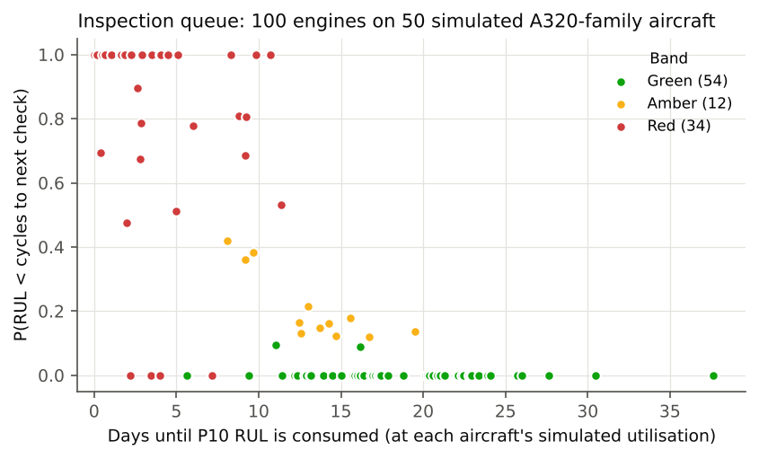
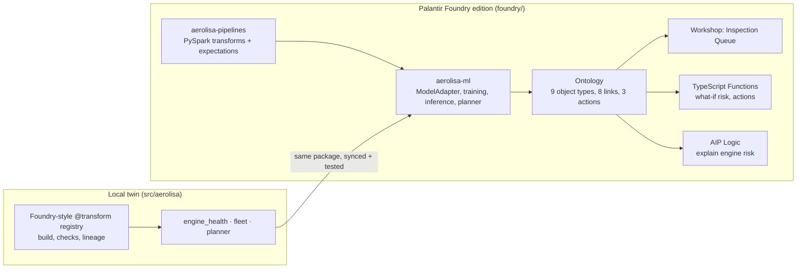

# Aerolisa: data & AI for aerospace operations, on a Palantir Foundry ontology

> **Which engines in this fleet should we inspect first, why, and what happens if we wait?**
>
> Aerolisa answers that question end to end: PySpark pipelines, an aviation ontology, a
> remaining-useful-life model **with calibrated uncertainty**, label-free health monitoring,
> a cost-based alert, a risk-ranked inspection queue that converts cycles into days using each
> aircraft's utilisation, actions that write decisions back, and an AIP explanation that cites
> only ontology data. It is built for **Palantir Foundry** (the platform behind Airbus Skywise),
> with a tested local twin that runs on a laptop.
>
> It merges two projects: **Turbofan-RUL** (my CESI scientific research on NASA C-MAPSS) and
> **Aerolisa** (a Skywise-style fleet-health platform). The predictive-maintenance slice is
> finished; nine more aerospace & defence use cases are designed on the same ontology.

Independent personal project on public data only. Not affiliated with, endorsed by, or connected to
Airbus, Skywise or Palantir. Engines are NASA C-MAPSS simulations; the fleet is simulated and labelled as such.



## Results (NASA C-MAPSS FD001, 100 test engines, last cycle each)

| Model | Features | Test RMSE | NASA score ↓ | RMSE, critical zone (RUL < 50) |
|---|---|---|---|---|
| Linear Regression (SAA v1) | single cycle | 21.88 | 1307.6 | 23.91 |
| Random Forest (SAA v1) | single cycle | 18.09 | 914.7 | 16.48 |
| LSTM (SAA v1, Keras) | 30-cycle sequence | 15.41 | 423.3 | 6.14 |
| Windowed MLP | 30-cycle sequence | 14.69 | 356.2 | **3.89** |
| **Hist. Gradient Boosting (production)** | **30-cycle rolling mean / std / slope** | **14.01** | **292.2** | 5.69 |

| Decision layer | Result |
|---|---|
| Calibrated P10–P90 interval (80 % target) | **81 %** measured coverage (64 % before conformal calibration) |
| Alert "fails within 30 cycles" (P10 ≤ 25, cost 10:1) | **25 / 25** caught, 2 false alarms (point-estimate alert misses 3) |
| Label-free anomaly score, near-failure vs healthy | AUC **0.987**; sustained alarm a median **38.5 cycles** before failure |
| Reliability (100 run-to-failure engines) | Weibull β = 4.41 (wear-out), B10 = 135 cycles |

**The research finding:** when tabular models see the last 30 cycles as rolling statistics (exactly what a
Spark window transform computes in Foundry), they beat the LSTM. The temporal information mattered, not the
recurrent layer, and the cheaper model is easier to explain, calibrate and run on the platform.
Full study: `research/` and the SAA v2 report.

## What runs where



- **Same code twice:** the ML repository runs the exact `aerolisa` package tested here
  (`scripts/sync_foundry.py`; a test fails if the Foundry copy drifts). Foundry ML wiring is executed
  locally with fakes of `transforms.api` / `palantir_models` (`tests/test_foundry_ml_repo.py`).
- **PySpark twins:** each PySpark function mirrors a pandas function and is unit-tested in Foundry
  (`foundry/pipelines-repo/.../test_logic.py`). Spark is not run locally.
- **Ontology contract:** every property in `foundry/ontology/ontology.yaml` is checked against the
  local backing datasets (`tests/test_ontology_contract.py`).

## Use cases

| Domain | Use case | Status |
|---|---|---|
| Operations & MRO | Predictive maintenance & health monitoring | ✅ built |
| Operations & MRO | Automated visual inspection | 📐 designed |
| Operations & MRO | Technical documentation copilot (RAG) | 📐 designed |
| Flight efficiency | Route & fuel optimisation | 📐 designed |
| Flight efficiency | Air & space traffic management | 📐 designed |
| Sustainability | Decarbonisation & emissions | 📐 designed |
| Engineering | Generative design & surrogates | 📐 designed |
| Supply chain | Predictive supply-chain resilience | 📐 designed |
| Safety & autonomy | Autonomous flight & cockpit assistance | 📐 designed |
| Safety & autonomy | Explainable AI & certification readiness | 🟡 partly built in PdM |

Designs, data sources and ontology extensions: [docs/use-cases.md](docs/use-cases.md).

## Quick start (local twin)

```bash
git clone https://github.com/xdmanflow/Aerolisa.git && cd Aerolisa
python -m venv .venv && source .venv/bin/activate
pip install -e ".[dev,research]"
make test        # 34 tests: pipelines, models, planner, ontology contract, Foundry ML wiring
make build       # raw C-MAPSS -> bronze -> silver -> gold -> objects, with checks (≈15 s)
make lineage     # docs/lineage.md
make research    # reproduces every number and figure of the SAA v2 report (≈2 min)
```

Foundry edition: **[docs/foundry-build-guide.md](docs/foundry-build-guide.md)** (16 steps, each with a check and a screenshot).

## Repository structure

```text
Aerolisa/
├── src/aerolisa/               # local twin: pure, tested logic (also vendored into Foundry)
│   ├── core/                   # schema constants, Foundry-style @transform registry, build, lineage
│   ├── pipelines/              # C-MAPSS bronze -> silver -> labels
│   ├── engine_health/          # features, RUL model + conformal interval, health index, anomaly, reliability, bundle
│   ├── fleet/                  # simulated fleet & utilisation (OpenSky connector in Foundry)
│   ├── planner/                # risk before next check, ranking, reasons, what-if
│   └── cli/                    # pipeline graph + `python -m aerolisa.cli build|lineage|catalog`
├── foundry/
│   ├── pipelines-repo/         # Code Repository (Python transforms, PySpark) + tests
│   ├── ml-repo/                # Code Repository (Model Training template): adapter, training, inference, planner
│   ├── functions-repo/         # TypeScript Functions: what-if risk, actions
│   ├── ontology/ontology.yaml  # object, link and action types
│   ├── workshop/ aip/ analyses/ pipeline-builder/   # app, AIP Logic, Quiver/Contour, low-code specs
│   └── screenshots/            # filled while following the build guide
├── research/                   # SAA: v1 (original LSTM study) + v2 experiments, results, figures
├── docs/                       # build guide, use cases, architecture, model card, risk, skills map, demo, ADRs
├── sql/                        # Spark SQL analyses (Foundry SQL / Contour)
├── data/raw/cmapss/            # NASA C-MAPSS FD001 (public); all other data/ is generated and git-ignored
└── tests/
```

## Tech stack
**Platform:** Palantir Foundry (Code Repositories, Pipeline Builder, Ontology Manager, Functions, Actions, Workshop, Quiver, Contour, AIP Logic, Data Lineage, Data Health)
**Data engineering:** Python, PySpark (window functions, joins, expectations), SQL, pandas
**ML:** scikit-learn (gradient boosting, quantile regression, Isolation Forest, PCA), conformal prediction, survival analysis (Kaplan–Meier, Weibull), TensorFlow/Keras (SAA v1 LSTM)
**Engineering:** pytest, ruff, GitHub Actions, TypeScript

## Learning companion
Every component maps to the skills of a data engineer / analyst / scientist on a Skywise-style team:
[docs/skills-map.md](docs/skills-map.md). It is the applied side of **Renaissance**, my data & AI curriculum.

## Author
**Manil DOUDOU**, engineering student in computer science (AI & data science), CESI Toulouse ·
[GitHub](https://github.com/xdmanflow) · [LinkedIn](https://www.linkedin.com/in/manil-doudou)

## License
Code: MIT. Data: NASA C-MAPSS (public), all other data simulated. Saxena, A., Goebel, K., Simon, D., Eklund, N. (2008),
*Damage Propagation Modeling for Aircraft Engine Run-to-Failure Simulation*, PHM08.
