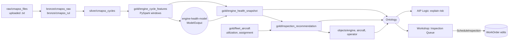

# Foundry build guide: predictive maintenance & health monitoring, end to end

You implement; the code is ready. Follow the steps in order: each one ends with a
**check** (what you must see) and a **screenshot** to save in `foundry/screenshots/`.
Plan **6 to 8 Sunday sessions**. When something differs from what's written here
(Foundry changes often), the Foundry docs win: note the difference in
`foundry/README.md` → "What I hit while porting". That paragraph is interview material.

> Rules: public data only (NASA C-MAPSS + simulated fleet). Nothing from ALTEN or any employer.
> Check the Developer Tier terms before you publish screenshots or a video.

## Map of what you will build

| Repo / app | Folder here | Skills it trains |
|---|---|---|
| Code Repository **aerolisa-pipelines** (Python transforms) | `foundry/pipelines-repo/` | PySpark, window functions, data expectations, file-based ingestion, unit tests, branches & PRs |
| Code Repository **aerolisa-ml** (Model Training template) | `foundry/ml-repo/` | `palantir_models`, ModelAdapter, ModelOutput/ModelInput, batch inference, pandas in transforms |
| Ontology Manager | `foundry/ontology/ontology.yaml` | object/link/action types, edits, writeback |
| Functions repository (TypeScript) | `foundry/functions-repo/` | Functions on objects, OntologyEditFunction, aggregations |
| Workshop | `foundry/workshop/inspection-queue.md` | operational apps, variables, actions in UI |
| Quiver, Contour | `foundry/analyses/` | analysis without code, time series, KPIs |
| Pipeline Builder | `foundry/pipeline-builder/` | low-code pipelines (same silver step, the other way) |
| AIP Logic | `foundry/aip/explain-engine-risk.md` | LLM on the ontology, grounding, evaluation |

---

## Step 0 · Before Foundry (30 min)
1. Locally: `pip install -e ".[dev,research]"`, then `make test` (34 tests green) and `make build`.
   You now have every dataset in `data/` as CSV: these are the **expected outputs** you will
   compare Foundry against (row counts, a few values).
2. `python scripts/sync_foundry.py --check` → "up to date".

**Check:** `data/objects/engine.csv` has 100 rows. Note 3 values (e.g. FD001-FLEET-076 → rank 1, RED).

## Step 1 · Project and folders
Create a Project `Aerolisa` with folders `raw`, `bronze`, `silver`, `gold`, `objects`, `writeback`, `models`.
Edit `PROJECT` in both `paths.py` files to that location.
**Screenshot:** `01_project.png` (folder tree).

## Step 2 · Upload raw data
New → Dataset → upload `train_FD001.txt`, `test_FD001.txt`, `RUL_FD001.txt` **as files**
(no schema) into `raw/cmapss_files`.
**Check:** the dataset shows 3 files, no schema. **Screenshot:** `02_raw_upload.png`.

## Step 3 · Code Repository `aerolisa-pipelines`
1. New → Code Repository → **Python transforms**. Name it `aerolisa-pipelines`.
2. Create a branch `feature/cmapss-pipeline` (never work on master).
3. Copy `foundry/pipelines-repo/transforms-python/src/aerolisa_pipelines/` into the repo's
   `transforms-python/src/` (replace the example package; keep the `setup.py`/`meta.yaml`
   the template generated, and update the package name in them if needed).
4. Copy `src/test/test_logic.py`. Commit → the checks run the tests.
5. Build `bronze/cmapss_raw`, `bronze/cmapss_rul`, then `silver/cmapss_cycles`, then
   `gold/engine_cycle_features` and `gold/engine_life_records` (Preview first, then Build).

**Check:** silver = **33,727 rows**; `gold/engine_cycle_features` has 78 columns;
engine `FD001-FLEET-001` last cycle has `rul = 112`; expectations all green.
**Screenshots:** `03_repo_code.png`, `04_build_green.png`, `05_expectations.png`.

> Interview line: "the logic lives in `logic/` with no Foundry imports, so I unit-test it
> with the `spark_session` fixture; the `datasets/` files only wire paths and checks."

## Step 4 · Pull request
Open a PR from your branch, review your own diff, merge, rebuild on master.
**Screenshot:** `06_pull_request.png`.

## Step 5 · Code Repository `aerolisa-ml` (Model Training template)
1. New → Code Repository → **Model Training** template, name `aerolisa-ml`.
2. Copy `foundry/ml-repo/src/aerolisa/` (vendored, tested package) next to the template's
   `model_adapters` and `model_training` folders, then replace the template's adapter with
   `model_adapters/adapter.py` and add the three files of `model_training/`.
3. Libraries (Libraries panel): `scikit-learn`, `scipy`, `pandas`, `numpy` (and `dill` if not present).
4. Register the transforms in the template's pipeline file (same `discover_transforms` pattern).
5. Build in this order: `gold/fleet_aircraft` → `gold/aircraft_utilization_daily` →
   `gold/engine_assignment` → **train** (`models/engine-health-model` + `gold/engine_health_model_metrics`)
   → **inference** `gold/engine_health_snapshot` → `gold/inspection_recommendation` → `gold/reliability_km`.

**Check:** metrics dataset: `test_rmse ≈ 13.98`, `test_interval_coverage = 0.81`,
`alert_threshold_cycles = 25` (same as local: same code, same seed). Snapshot = **13,096 rows**.
The model page shows version 1 with the adapter API.
**Screenshots:** `07_model_page.png`, `08_metrics_dataset.png`.

> If `palantir_models` imports fail, copy the import lines from the template's example adapter:
> only the imports change, not the logic.

## Step 6 · Ontology backing datasets
Back in `aerolisa-pipelines`, build `objects/engine`, `objects/aircraft`, `objects/operator`,
`writeback/work_orders`.
**Check:** `objects/engine` = 100 rows, primary-key expectation green.

## Step 7 · Schedule, break, trace (data health)
1. Schedule: build `objects/engine` daily with "build upstream" (Schedules).
2. Break it on purpose: on a branch, make `silver_cycles` emit a duplicate row
   (`df.unionByName(df.limit(1))`). Build → the primary-key expectation **fails**.
3. Open **Data Lineage** from `objects/engine`, find the red node, read the check message.
4. Revert. Write 3 lines in `foundry/README.md` on what you saw.
**Screenshots:** `09_schedule.png`, `10_lineage_failure.png`.

## Step 8 · Pipeline Builder (the low-code twin)
Rebuild only `silver/cmapss_cycles` in Pipeline Builder as `silver/cmapss_cycles_pb`,
following `foundry/pipeline-builder/silver-cleaning.md`. Compare row counts with the code version.
**Screenshot:** `11_pipeline_builder.png`.

## Step 9 · Object types
In Ontology Manager create, from `foundry/ontology/ontology.yaml`: **Engine, Aircraft, Operator,
EngineHealthSnapshot, InspectionRecommendation, WorkOrder, UtilizationDay, EngineLifeRecord, ModelVersion**.
Use the API names as written (the TypeScript code depends on them). Enable **edits** on
InspectionRecommendation and WorkOrder. Add conditional formatting on `band`
(RED/AMBER/GREEN) with an icon, never colour alone.
**Screenshot:** `12_object_types.png`.

## Step 10 · Link types
Create the 8 links of `ontology.yaml` (foreign-key links).
**Check:** Object Explorer → open engine FD001-FLEET-076 → you see its aircraft, 205 snapshots (one per cycle),
1 recommendation. **Screenshot:** `13_object_explorer.png`.

## Step 11 · Functions + action types
1. New → Code Repository → **Functions (TypeScript)** `aerolisa-functions`. Import the object
   types (Resource imports). Paste `foundry/functions-repo/src/index.ts` and the test file.
2. Run tests, publish (tag a release).
3. Create action types **ScheduleInspection**, **AcknowledgeRecommendation**, **CloseWorkOrder**,
   each "backed by function", with the parameters and submission criteria of `ontology.yaml`.
**Check:** run ScheduleInspection on rank 1 in Object Explorer: a WorkOrder appears, the
recommendation's status becomes SCHEDULED. **Screenshot:** `14_action.png`.

## Step 12 · Workshop app "Aerolisa · Inspection Queue"
Build it from `foundry/workshop/inspection-queue.md` (3 pages, variables, the what-if slider).
**Check:** three clicks from the queue to a scheduled inspection.
**Screenshots:** `15_workshop_queue.png`, `16_workshop_engine.png`.

## Step 13 · Quiver and Contour
Follow `foundry/analyses/quiver-contour.md`: engine health over time (Quiver), fleet KPIs
and reliability table (Contour). **Screenshots:** `17_quiver.png`, `18_contour.png`.

## Step 14 · AIP Logic "Explain this engine's risk"
Follow `foundry/aip/explain-engine-risk.md`; run the 10 evaluation questions; record the score.
Add the function to the Engine page of the Workshop app. **Screenshot:** `19_aip_logic.png`.

## Step 15 · Recording
2-minute screen recording following `docs/demo-script.md` (Foundry part).
Tag the GitHub repo `v1.0.0-foundry`.

## Optional · Step 16 · Real flights (OpenSky)
Create a REST source in Data Connection, choose ~20 real A320-family airframes of one
operator, enable `datasets/opensky.py`, and derive real cycles/day to replace
`gold/aircraft_utilization_daily`. Engines stay simulated and labelled as such.

---

## Troubleshooting notes (fill as you go)
| Symptom | Cause | Fix |
|---|---|---|
| | | |
