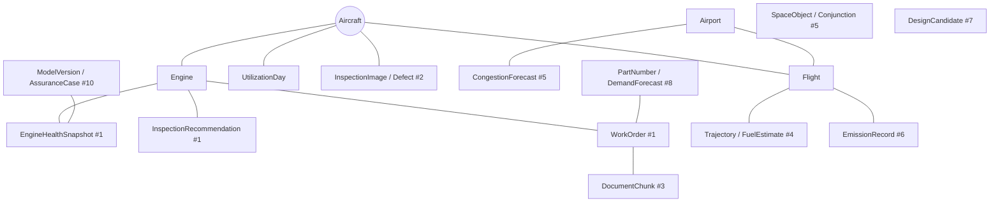

# Aerolisa use-case catalogue: data & AI across aerospace & defence

One ontology, many applications. Every use case below plugs into the same object model
(Aircraft is the hub) and the same Foundry building blocks, which is how a platform like
Skywise grows: new datasets and models attach to objects that already exist.

| # | Domain | Use case | Status | Audience |
|---|---|---|---|---|
| 1 | Operations & MRO | **Predictive maintenance & health monitoring** | ✅ **Built** (local twin + Foundry code; research = SAA v2) | CESI + Airbus |
| 2 | Operations & MRO | Automated visual inspection | 📐 Designed | Airbus |
| 3 | Operations & MRO | Unstructured technical documentation (copilot) | 📐 Designed | Airbus |
| 4 | Flight efficiency | Route & fuel optimisation | 📐 Designed | Airbus |
| 5 | Flight efficiency | Air & space traffic management | 📐 Designed | Airbus |
| 6 | Sustainability | Decarbonisation & emissions modelling | 📐 Designed | Airbus |
| 7 | Engineering | Generative design & surrogate models | 📐 Designed | Airbus |
| 8 | Supply chain | Predictive supply-chain resilience | 📐 Designed | Airbus |
| 9 | Safety & autonomy | Autonomous flight & cockpit assistance | 📐 Designed | Airbus |
| 10 | Safety & autonomy | Explainable AI & certification readiness | 🟡 Partly built (inside #1) | CESI + Airbus |

Legend: ✅ code + results · 🟡 elements already live in #1 · 📐 design ready, build later (see ROADMAP).
Rule kept from Aerolisa v0: **public or simulated data only**, labelled everywhere.

---

## 1 · Predictive maintenance & health monitoring ✅
**Question:** which engines should we inspect first, why, and what happens if we wait?
**Built:** C-MAPSS → bronze/silver/gold (PySpark) → RUL with calibrated P10/P50/P90 →
health index + anomaly score + drivers → cost-based alert → risk before next check using
aircraft utilisation → ranked, explained queue → ScheduleInspection action with writeback →
AIP explanation. Reliability (Kaplan–Meier, Weibull).
**Results (FD001 test, 100 engines):** RMSE 13.98 cycles, NASA score 291, critical-zone RMSE 5.69,
interval coverage 81 % (80 % target), alert recall 25/25 with 2 false alarms. Details: `research/`, `docs/model-card.md`.
**Next:** N-CMAPSS (NASA, real flight-condition profiles) and FD002–FD004 with operating-condition
normalisation; work-order findings as feedback labels.

## 2 · Automated visual inspection
**Problem:** manual walk-arounds and borescope reviews are slow and miss small defects.
**Data (public):** NEU-DET steel surface-defect images as a stand-in for surface damage; community
aircraft-damage image sets (check each licence); later, borescope-like frames from public videos are **not** used (licence).
**Approach:** transfer-learning detector (YOLO-family or Faster R-CNN), active learning loop, a
human-in-the-loop review queue; severity → WorkOrder.
**Ontology:** `InspectionImage` (media reference) → `Defect` (type, bbox, confidence, reviewed_by) → links to Aircraft / Engine / WorkOrder.
**Foundry:** media sets, model training template (PyTorch adapter), Workshop review app with accept/reject actions (labels for retraining).
**Done when:** mAP reported on a held-out split; a reviewer can confirm a defect and create a work order in 2 clicks.
**Skills:** computer vision, PyTorch, media sets, labelling loops.

## 3 · Unstructured technical documentation (maintenance copilot)
**Problem:** technicians lose time searching manuals, logs and past repairs during turnarounds.
**Data (public):** FAA Aviation Maintenance Technician Handbooks (General, Airframe, Powerplant, US public domain),
FAA Advisory Circulars, NASA ASRS safety reports (public), NTSB aviation accident data.
**Approach:** document parsing → chunks with page references → hybrid retrieval (embeddings + BM25) →
answers with citations and refusal when not covered; tools on the ontology (`get_engine`, `rank_inspections`);
proposed actions require a human click. 30-question evaluation set.
**Ontology:** `Document` → `DocumentChunk`; `WorkOrder` linked to the chunks that justified it.
**Foundry:** AIP Logic / AIP Agent Studio, semantic search on chunks, Workshop panel.
**Done when:** ≥ target retrieval recall on the eval set, every answer cites a page, zero unconfirmed edits.
**Skills:** RAG, embeddings, prompt engineering, LLM evaluation.

## 4 · Route & fuel optimisation
**Problem:** flown routes differ from the most efficient ones; fuel is the biggest variable cost.
**Data (public):** OpenSky trajectories (research terms), ERA5 reanalysis winds (Copernicus), OpenAP open aircraft
performance / fuel-flow model (TU Delft), OurAirports.
**Approach:** (a) inefficiency = flown distance vs great-circle per city pair, by month and airport;
(b) fuel estimate per flight with OpenAP; (c) wind-optimal route on a grid (A*/Dijkstra) vs flown route → potential saving.
**Ontology:** `Flight` → `Trajectory` (H3 cells), `FuelEstimate`; links to Airport and Aircraft.
**Foundry:** incremental transforms for trajectories, geospatial in Contour/Workshop map, Quiver for time series.
**Done when:** a memo answers "how much extra distance/fuel on route X, and why" with defendable numbers.
**Skills:** geospatial, optimisation, Spark at scale, aviation performance.

## 5 · Air & space traffic management
**Problem:** congestion at hubs; growing satellite and debris population.
**Data (public):** OpenSky arrivals/departures (airport congestion); CelesTrak TLEs (orbital elements).
**Approach:** airport hourly demand forecasting (gradient boosting with calendar/weather features);
satellite conjunction screening with SGP4 propagation and closest-approach search for a chosen catalogue subset.
**Ontology:** `Airport` → `CongestionForecast`; `SpaceObject` → `Conjunction` (time, miss distance, probability proxy).
**Foundry:** scheduled builds, Workshop map/timeline, alerting via actions.
**Done when:** hourly forecast beats a seasonal-naive baseline; conjunction list reproduces a known close approach.
**Skills:** time-series forecasting, orbital mechanics basics, simulation.

## 6 · Decarbonisation & emissions modelling
**Problem:** operators must track CO₂ and reduce contrails to meet net-zero commitments.
**Data (public):** flights + OpenAP fuel (from #4) → CO₂ = 3.16 × fuel; ERA5 temperature/humidity for
contrail-formation conditions (Schmidt–Appleman criterion); published SAF life-cycle factors (ICAO CORSIA documents).
**Approach:** fleet carbon ledger (per flight, aircraft, route); contrail-risk flag per trajectory segment;
SAF blend scenarios (what-if on blend %, cost, CO₂).
**Ontology:** `EmissionRecord` per Flight; `SafScenario` with what-if parameters.
**Foundry:** Workshop scenarios (Foundry scenarios / what-if), Quiver KPIs.
**Done when:** monthly CO₂ per aircraft with a stated method and uncertainty; one SAF scenario explained.
**Skills:** sustainability analytics, scenario modelling, data storytelling.

## 7 · Generative design & surrogate models
**Problem:** high-fidelity simulation is too slow to explore many designs.
**Data (public):** AirfRANS (RANS simulations around airfoils), UIUC airfoil coordinate database.
**Approach:** surrogate model (gradient boosting → graph/neural network) predicting lift/drag from geometry;
optimisation loop (Bayesian optimisation / genetic algorithm) proposing new shapes; constraint checks.
**Ontology:** `DesignCandidate` (geometry, predicted Cl/Cd, uncertainty, status) → `SimulationRun`.
**Foundry:** model training template, Workshop review of candidates, action "send to high-fidelity simulation".
**Done when:** surrogate error reported on held-out airfoils; optimiser finds a candidate better than the baseline, with uncertainty.
**Skills:** scientific ML, optimisation, uncertainty.

## 8 · Predictive supply-chain resilience
**Problem:** production ramp-ups and AOG events are blocked by late or missing parts.
**Data (public / simulated):** Airbus monthly orders & deliveries (public figures), **predicted removals from #1**
(Engine → WorkOrder), simulated parts catalogue and lead times.
**Approach:** intermittent-demand forecasting (Croston/TSB vs ML), demand driven by predicted removals,
inventory optimisation (service level vs holding cost), bottleneck risk scoring.
**Ontology:** `PartNumber`, `Supplier`, `DemandForecast`, `StockPosition`; WorkOrder → PartNumber.
**Foundry:** the strongest Foundry story: maintenance predictions flow into supply-chain decisions on the same ontology.
**Done when:** service level vs inventory curve; one example where a predicted removal changes a stock decision.
**Skills:** forecasting, operations research, business KPIs.

## 9 · Autonomous flight & cockpit assistance
**Problem:** crews need help in high-workload situations; unmanned systems must navigate safely.
**Data / tools (public):** JSBSim open flight-dynamics model; FAA Airplane Flying Handbook (public domain) for checklists.
**Approach:** (a) cockpit assistant = retrieval over checklists + current simulated state, suggesting the next checklist item
(human decides); (b) a learned controller (imitation or reinforcement learning) for a simple task (altitude hold) in simulation,
compared against a PID baseline, with a safety envelope monitor.
**Ontology:** `SimulationScenario`, `ChecklistItem`, `AssistantSuggestion`.
**Done when:** controller tracking error vs PID on fixed scenarios; assistant suggestions evaluated on 20 scripted situations.
**Skills:** control, RL basics, safety-critical design.

## 10 · Explainable AI & certification readiness 🟡
**Problem:** regulators require transparent, auditable ML before mission-critical use (EASA AI Roadmap 2.0;
EASA concept paper on Level 1 & 2 machine-learning applications).
**Already in #1:** data lineage and expectations (data quality), model card, calibrated intervals, documented
alert threshold from a cost table, per-engine drivers, out-of-distribution signal (anomaly score),
human-in-the-loop actions with audit trail (WorkOrder created_by/at), model versions as objects.
**Next:** an "assurance case" document mapping each artefact to learning-assurance objectives
(data management, learning process, verification, explainability, human oversight); monotonic constraints
on key sensors; robustness tests (sensor noise, missing sensor); drift monitoring on new data.
**Ontology:** `ModelVersion` → `AssuranceEvidence` (objective, artefact link, status).
**Done when:** a reviewer can trace one RED recommendation back to its raw data, model version, metrics and human decision.
**Skills:** AI governance, MLOps, verification.
