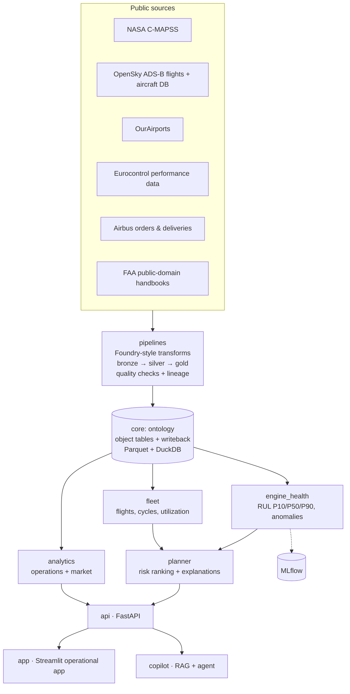

# Aerolisa: fleet health intelligence on an aviation ontology

> **Which engines in this fleet should we inspect first, why, and what happens if we wait?**
>
> Aerolisa answers that question end to end: ingestion pipelines, an aviation ontology, predictive maintenance models with uncertainty, real flight cycles from ADS-B, an operational app where planners take action, and an AI copilot that cites its sources. It is built twice: locally in open-source Python, and on **Palantir Foundry** (the platform behind Airbus Skywise).
>
> Independent personal project on public data only. Not affiliated with, endorsed by, or connected to Airbus, Skywise or Palantir. The fleet is simulated where stated; nothing here is real airline maintenance data.

## Demo

_Live demo link, GIF and Foundry edition video are added at milestone M1 and updated at every milestone._

## How it works

1. **Real flights.** Real A320-family airframes are tracked through the OpenSky Network; their flights become `Flight` objects and **cycles per day**.
2. **Simulated engines, labelled as such.** NASA C-MAPSS run-to-failure engines are assigned to those airframes. Each engine ages with its aircraft's **real** cycles.
3. **Engine health.** Models predict remaining useful life **with an interval** (P10 / P50 / P90) and an anomaly score, with an explanation of the main drivers.
4. **Decision.** The planner converts "cycles left" into "days left" using each aircraft's real utilization, ranks engines by risk, and explains each rank. A planner can **schedule an inspection**: the decision is written back into the data, like a Foundry action.
5. **Copilot.** An LLM agent answers questions using tools on the ontology and public-domain maintenance documents, with citations, and proposes actions that a human must confirm.

## Why this mirrors Skywise

Skywise's public fleet-performance products cover health monitoring, predictive maintenance and reliability. Aerolisa rebuilds that idea at small scale, with the same building blocks Foundry uses:

| Foundry / Skywise idea | Aerolisa (local) | Aerolisa (Foundry edition) |
|---|---|---|
| Datasets, transforms, lineage | Foundry-style `@transform` pipelines on Parquet, lineage graph | Pipeline Builder + Code Repositories |
| Ontology: objects, links, actions | `ontology/` definitions, object tables, writeback | Ontology Manager, action types |
| Operational apps | Streamlit app (Workshop-like) | Workshop app |
| Predictive maintenance / health monitoring | `engine_health` + `planner` | Datasets + Functions |
| AIP | Copilot with tools and human confirmation | AIP Logic |

Full mapping and interview notes: [docs/skywise-foundry-mapping.md](docs/skywise-foundry-mapping.md).

## Architecture



Design rules ([docs/architecture.md](docs/architecture.md)): ontology first · domain modules import only `core` · always demoable · public data only, never committed · runs offline on `sample_data/`.

## Milestones

Each milestone ships something a recruiter can see. Steps for every milestone: **[ROADMAP.md](ROADMAP.md)**.

| | Milestone | What it shows | Status |
|---|---|---|---|
| M0 | Clean slate | Tooling, CI, accounts | ☐ |
| M1 | **MVP: engine health slice** | Pipeline → model → live app, end to end | ☐ |
| M2 | Data platform | PySpark Foundry-style transforms, quality, lineage, `aerolisa build` | ☐ |
| M3 | Ontology | Object, link and action types; writeback | ☐ |
| M4 | **Foundry edition** | The same flow on Palantir Foundry | ☐ |
| M5 | Fleet from real flights | OpenSky flights → cycles per airframe | ☐ |
| M6 | Engine health v2 | Multi-condition models, intervals, anomalies, MLflow, model card | ☐ |
| M7 | **Planner & operational app** | Ranked, explained inspection queue with actions; API | ☐ |
| M8 | Analytics pack | SQL, KPIs, dashboard and insight memo on European ops + Airbus deliveries | ☐ |
| M9 | Industrialization | Docker Compose, CI/CD, scheduled refresh | ☐ |
| M10 | **Copilot** | Grounded RAG + agent with evaluation; AIP Logic twin | ☐ |
| M11 | Showcase | Demo video, case study, portfolio | ☐ |

## Results

_Metrics, screenshots and evaluation reports are added as each milestone lands. No result is claimed before it is measured._

## Tech stack

**Data engineering:** Python, PySpark, SQL, DuckDB, Parquet, pandera
**Machine learning:** scikit-learn, LightGBM / XGBoost, lifelines, PyTorch, SHAP, MLflow
**Apps & APIs:** FastAPI, Streamlit, Plotly
**GenAI:** an LLM API, embeddings, Chroma, hybrid retrieval, evaluation set
**Platform:** Palantir Foundry (Pipeline Builder, Code Repositories, Ontology, Workshop, Quiver, Contour, AIP Logic)
**Engineering:** Git, GitHub Actions, Docker Compose, pytest, Ruff, pre-commit

## Repository structure

```text
Aerolisa/
├── src/aerolisa/
│   ├── core/            # config, paths, Foundry-style transform API, dataset catalog, ontology models
│   ├── pipelines/       # sources + bronze/silver/gold transforms + quality checks
│   ├── engine_health/   # RUL with intervals, anomaly detection, explanations
│   ├── fleet/           # flight segmentation, cycles and utilization, engine assignment
│   ├── analytics/       # operations (Eurocontrol) and market (Airbus O&D) analytics
│   ├── planner/         # risk ranking, explanations, what-if
│   ├── api/             # FastAPI: objects, planner, actions
│   ├── copilot/         # RAG over public documents + agent with ontology tools
│   └── cli/             # `aerolisa build`, `aerolisa quality`, `aerolisa lineage`
├── ontology/            # object, link and action type definitions (created at M3)
├── app/                 # Streamlit operational app (Workshop-like)
├── foundry/             # Foundry edition: exported transforms, screenshots, notes
├── sql/                 # documented analytical queries
├── dags/                # optional Airflow DAGs (M9)
├── docs/                # architecture, ontology, mapping, case study, model card, ADRs
├── infra/               # Dockerfiles
├── notebooks/           # exploration only, never imported
├── reports/             # quality, evaluation and analytics reports
├── sample_data/         # tiny samples so everything runs offline
├── tests/
├── ROADMAP.md · CHANGELOG.md · CONTRIBUTING.md · SECURITY.md
└── pyproject.toml · Makefile · docker-compose.yml
```

## Quick start

> 🚧 Early development. Commands grow with each milestone.

```bash
git clone https://github.com/xdmanflow/Aerolisa.git
cd Aerolisa
python -m venv .venv && source .venv/bin/activate
make install          # Aerolisa + dev tools
make test             # tests, including the architecture rule
cp .env.example .env  # local settings; never commit .env
make up               # local services (MLflow now; more per milestone)
```

## Data sources

| Source | Used for | Terms |
|---|---|---|
| NASA C-MAPSS turbofan degradation simulation | Engine health, planner | Public NASA dataset; downloaded at runtime |
| OpenSky Network REST API + aircraft database | Flights, cycles, airframes | OpenSky terms of use (non-commercial research); raw data never redistributed |
| OurAirports | Airport reference data | Public domain |
| Eurocontrol performance data (ansperformance.eu) | Operations analytics | Eurocontrol terms |
| Airbus orders & deliveries (airbus.com) | Market analytics | Airbus site terms; not redistributed |
| FAA Aviation Maintenance Technician Handbooks | Copilot corpus | US government works (public domain) |

Details: [docs/data-sources.md](docs/data-sources.md).

## Learning companion

Aerolisa is the applied side of **[Renaissance](https://github.com/xdmanflow/Renaissance)**, my public data & AI curriculum. Each Renaissance module names the Aerolisa milestone it feeds.

## Author

**Manil DOUDOU**, engineering student in computer science (AI & data science), CESI Toulouse.

## License

Code under the [MIT License](LICENSE). Data remains under its original owners' terms.
