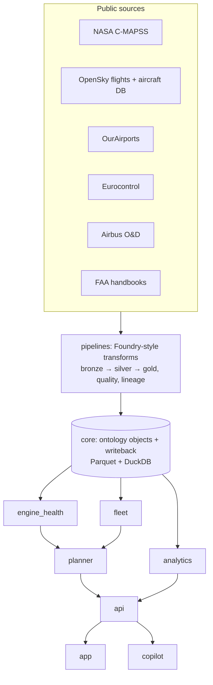

# Architecture



## Layers

1. **Sources:** public datasets and APIs, downloaded at runtime into `data/raw/` (git-ignored).
2. **Pipelines** (`aerolisa.pipelines`): transforms declared with the Foundry-style `@transform` API from `aerolisa.core`. Layers:
   - `bronze/` raw as received + ingestion metadata
   - `silver/` cleaned, typed, deduplicated, one table per real-world thing
   - `gold/` features, model outputs, aggregates
   - `objects/` ontology object tables (one per object type)
   - `writeback/` decisions made through action types (append-only, audited)
3. **Core** (`aerolisa.core`): config, paths, the transform API and build runner, the dataset catalog, ontology models, the action engine.
4. **Domain modules:** `engine_health`, `fleet`, `analytics`. Each reads objects/datasets and produces datasets; none imports another.
5. **Applications:** `planner` (combines engine health and fleet), `api` (FastAPI), `copilot` (RAG + agent), the Streamlit `app/`, and the `cli`.
6. **Platform:** DuckDB for SQL serving, MLflow for experiments and models, Docker Compose, GitHub Actions.

## Dependency rule

Arrows point to what a component may import.

```text
core  ←  pipelines, engine_health, fleet, analytics  ←  planner  ←  api  ←  copilot
                                                                    cli → anything
```

| Component | May import |
|---|---|
| `core` | nothing from Aerolisa |
| `pipelines`, `engine_health`, `fleet`, `analytics` | `core` |
| `planner` | `core`, `engine_health`, `fleet` |
| `api` | `core`, `engine_health`, `fleet`, `analytics`, `planner` |
| `copilot` | `core`, `api`, `planner` |
| `cli` | everything |

Enforced by [tests/test_architecture.py](../tests/test_architecture.py). Cross-component imports must be absolute (`from aerolisa.core import …`). The Streamlit app talks to the API (or, before M7, to `core` readers), never to module internals.

## Why local first, then Foundry

The local stack proves I understand what Foundry does under the hood (transforms, lineage, ontology, actions). The Foundry edition proves I can use the real platform. Same dataset names, same object types: an interviewer can compare them side by side. See [skywise-foundry-mapping.md](skywise-foundry-mapping.md).

## Decisions
See [adr/](adr).
