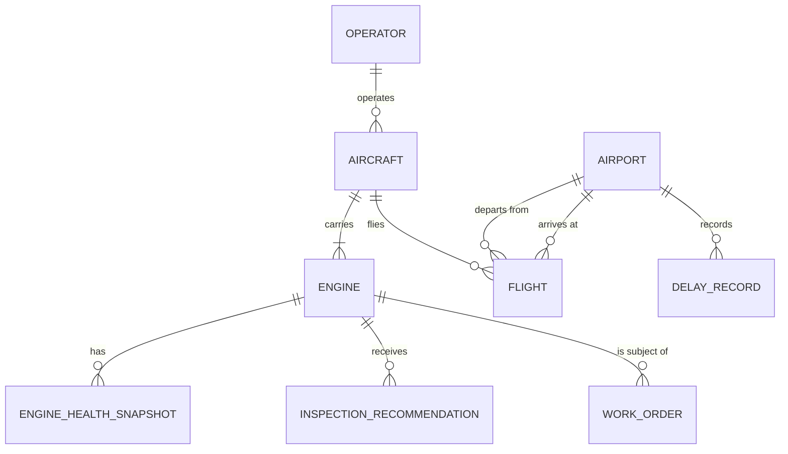

# Ontology (design v1)

> Starting design, to be challenged in Renaissance modules 03 and 07 and finalized at milestone M3. The executable definition will live in `ontology/ontology.yaml`; this page explains the *why*.

## Object types

| Object type | Primary key | Key properties | Backed by | Filled at |
|---|---|---|---|---|
| **Operator** | `icao_code` | name, country | `silver/aircraft_registry` | M5 |
| **Aircraft** | `icao24` | registration, typecode, family, operator, serial number | `silver/aircraft_registry` | M5 (static sample before) |
| **Engine** | `engine_id` | aircraft, position (1/2), C-MAPSS dataset + unit, start cycle, current cycle, `simulated = true` | `gold/engine_assignment` | M1 → M5 |
| **EngineHealthSnapshot** | `snapshot_id` | engine, as-of time, cycle, `rul_p10/p50/p90`, anomaly score, health index, top drivers, model version | `gold/engine_health_snapshot` | M1 → M6 |
| **Flight** | `flight_id` | aircraft, departure airport, arrival airport, first seen, last seen, duration, distance | `silver/flights` | M5 |
| **Airport** | `icao` | IATA, name, latitude, longitude, country | `silver/airports` | M2 |
| **InspectionRecommendation** | `recommendation_id` | engine, risk score, rank, reason, days to threshold, created at, status | `gold/inspection_recommendation` | M7 |
| **WorkOrder** | `work_order_id` | engine, type, planned date, status, created by, created at, comment, closing finding | `writeback/work_orders` | M3 → M7 |
| **DelayRecord** | `delay_id` | airport, date, cause, minutes | `silver/delays` | M8 |
| **DeliveryRecord** | `delivery_id` | month, family, region, count | `silver/deliveries` | M8 |

## Link types

## Action types

| Action | Parameters | Rules | Submission criteria |
|---|---|---|---|
| **ScheduleInspection** | engine, planned date, comment | create a WorkOrder (`status = planned`); set the engine's open recommendation to `scheduled` | planned date in the future; comment required if the engine is not in the top 10 |
| **AcknowledgeAlert** | recommendation, comment | set recommendation `status = acknowledged` | comment required |
| **CloseWorkOrder** | work order, finding (`none` / `minor` / `major`), comment | set `status = closed`, store finding | work order is `planned` |

Every action appends a row to `writeback/` with: action type, parameters, user, timestamp. Source datasets are never modified (same principle as Foundry writeback datasets).

## Design questions to settle at M3
- Snapshot as an object type, or a **time series property** on Engine (closer to how Quiver works)? Probably both: snapshots for decisions, time series for sensors.
- Should `Engine` stay linked to one aircraft, or carry an installation history (engines move between aircraft in real life)? An `Installation` object would model that; keep it in the 🚀 list.
- How to show `simulated = true` everywhere the user sees an engine.
